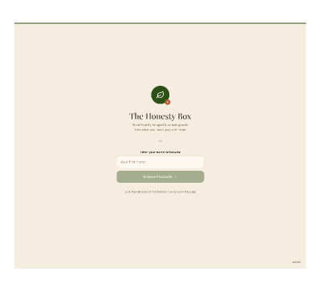

# The Honesty Box

A small React and SQLite application based on the original Figma Make export.
Customers check in with a name, browse goods, fill a basket and confirm what they
take. Out-of-stock items can be requested for a future visit. The admin can add
products, change stock and view orders. There are no prices or online payments.

## Run on your computer

Install **Node.js 24 LTS** (includes npm) and Git. Open a terminal in this folder:

```sh
npm ci
npm run dev
```

Open `http://localhost:3000`. The command starts the React development server
and the SQLite API together. Stop both with Ctrl+C.

Choose **Admin** on the welcome page. The local demo PIN is **1234**. To change it,
copy `.env.example` to `.env` and set `ADMIN_PIN`, then restart. Do not commit `.env`.
The application binds to your computer's loopback interface by default.

### VS Code and GitHub

1. In VS Code, open the Accounts menu and **Sign in with GitHub**.
2. Run **Git: Clone** from the Command Palette and enter
   `https://github.com/michello13/ChatgptConnect.git`.
3. Open the repository folder. The new application files must be present in that
   checkout; unpublished workspace changes are not downloaded by cloning.
4. Open **Terminal → New Terminal**, run `npm ci`, then `npm run dev`.
   Alternatively, select **Run Honesty Box** in Run and Debug and press F5.
5. Use Source Control to review, commit and sync changes to GitHub.

The `.vscode` folder provides run, build, install and test tasks. GitHub sign-in
on your computer is separate from the cloud workspace's GitHub access.

If you mean **Visual Studio 2022** rather than VS Code: use **Git → Clone
Repository**, sign in to GitHub, clone the same URL, and choose **File → Open →
Folder**. Run the npm commands in its terminal. This is a Node/React project,
so it does not need a .NET solution or Visual Studio build tools.

### Build and run without the development server

```sh
npm run build
npm start
```

The Node server serves the compiled site and API at `http://localhost:3000`.
No separate SQLite installation is needed: the server uses Node 24's built-in
`node:sqlite` module. Both Windows and macOS/Linux use the same npm commands.

## Where to change things

The application uses React, TypeScript, plain CSS and a small Express API.
There is no Bootstrap, Tailwind, component framework or generated routing layer.

| File                              | Purpose                                               |
| --------------------------------- | ----------------------------------------------------- |
| `src/app/App.tsx`                 | Screen navigation, customer name and basket state     |
| `src/components/CheckIn.tsx`      | Welcome screen and name form                          |
| `src/components/Catalog.tsx`      | Categories and product cards                          |
| `src/components/Basket.tsx`       | Available items and future requests                   |
| `src/components/Confirmation.tsx` | Order receipt                                         |
| `src/components/Admin.tsx`        | Admin login, inventory and order views                |
| `src/components/ProductForm.tsx`  | Add-product form                                      |
| `src/components/StockEditor.tsx`  | Explicit stock edit and Save action                   |
| `src/components/Brand.tsx`        | Shared branding                                       |
| `src/styles/theme.css`            | Colors, typography, layouts and responsive rules      |
| `src/types.ts`                    | Shared frontend data shapes                           |
| `src/api.ts`                      | All frontend HTTP calls                               |
| `server/app.mjs`                  | API routes and admin sessions                         |
| `server/database.mjs`             | SQLite schema, validation and stock transactions      |
| `server/seed.mjs`                 | Starter catalog, inserted only into an empty database |

Start with the CSS variables at the top of `theme.css` to change the palette.
Edit the corresponding component to change a screen. Inventory validation and
stock deductions live on the server, rather than being duplicated in React.

## Data and ordering rules

- SQLite data is stored at `data/honesty-box.sqlite`, outside version control.
  Orders and stock survive restarts. For a backup, stop the server and copy the
  `data` directory. Set `DB_PATH` to use a different file.
- Product prices are intentionally absent.
- Checkout validates current stock and commits all order items and stock changes
  in one transaction. Conflicting orders cannot reduce stock below zero.
- Backorders record demand without changing stock. They are accepted only for
  products that are currently out of stock. They are requests, not reservations.
- Admin routes require a server-side session. Sessions expire after eight hours
  or on logout/restart. Customer order history is not exposed publicly.
- The app records a customer's name, not their contact details. It does not send
  notifications or automatically fulfil backorders.
- Product photographs use external Unsplash URLs, with a leaf placeholder if
  unavailable. Fonts are bundled locally and need no Google Fonts connection.

### QR check-in

A QR code should point to the app's reachable address. `localhost` works only on
the computer running the server; a phone cannot use your computer's localhost.
For a trusted local network, set `HOST=0.0.0.0` in `.env`, restart, allow the local
firewall port, and use `http://YOUR-COMPUTER-LAN-IP:3000` as the QR destination.
Choose a private admin PIN before sharing. This local setup is not an Internet
deployment; public hosting needs HTTPS and suitable authentication.

Ports are configurable through `.env`: `PORT` defaults to `3000`; the development
API uses `API_PORT=3001`. Close other processes using those ports or choose new
ones. If changing `API_PORT`, restart `npm run dev` so the Vite proxy updates.

## Validation

```sh
npm test
npm run build
npx playwright install chromium
npm run test:browser
```

API tests use isolated databases. They cover checkout, stock conflicts and
rollback, invalid inputs, admin permissions, login throttling and persistence.
The browser test uses separate ports (3100/3101) and a temporary SQLite database;
it covers customer checkout, backorders, admin edits and mobile layout. It does
not alter your development data. With an existing Chromium installation, set
`PLAYWRIGHT_CHROMIUM_EXECUTABLE_PATH` to its executable instead of downloading.

## Original design

The original export remains intact at
[design/Inventory Management App.make](design/Inventory%20Management%20App.make).
Its original filename is retained; the preview displays “The Honesty Box.”



The React implementation follows the final request in the export's history:
remove prices, retain inventory statistics, add admin product creation and allow
future requests for out-of-stock items. The original interface provided the
visual reference; the components have been rewritten and SQLite persistence
added for this implementation.

Export SHA-256:

```text
c4d423ad6101ed21d2007f14fd3e1e1c07452d7676368c61d44813209d41b9d2
```
